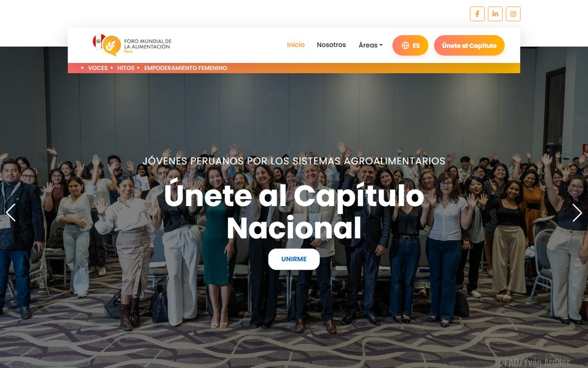
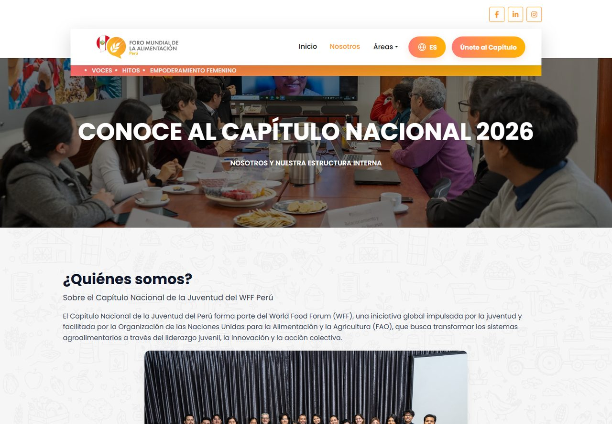
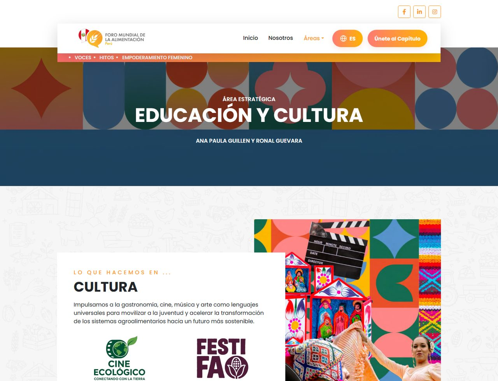
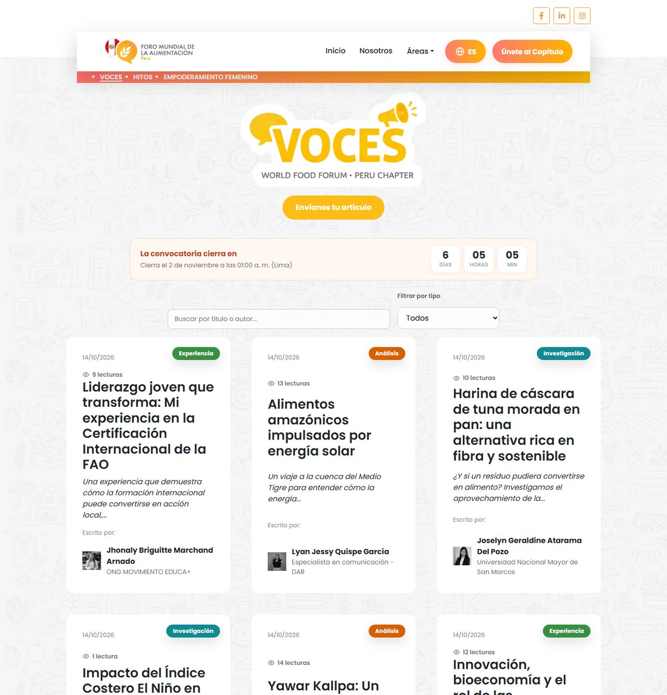
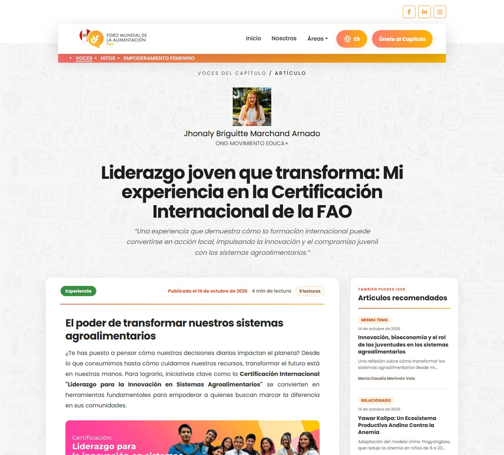
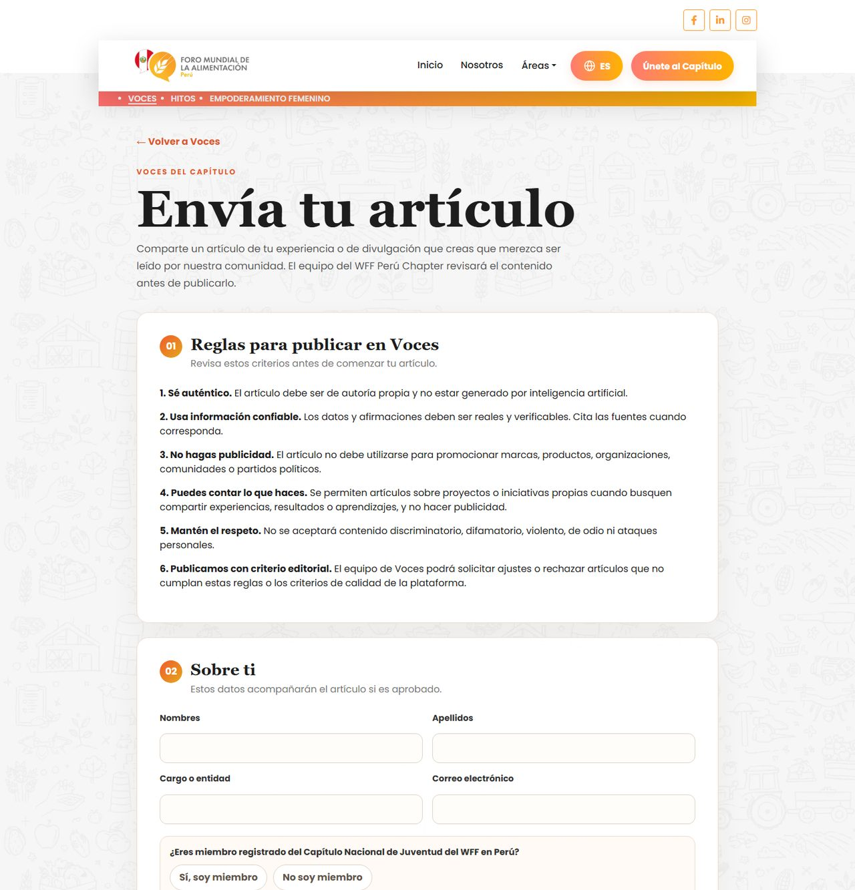
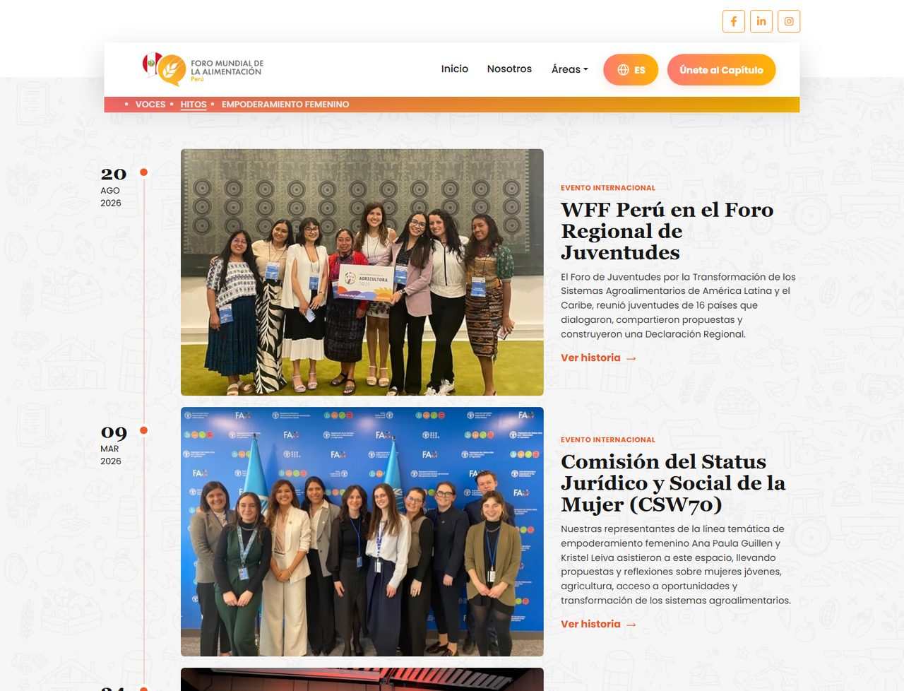

# WFF Perú Chapter

### La casa digital de la juventud peruana por los sistemas agroalimentarios

**[www.wffperuchapter.page](https://www.wffperuchapter.page)**

[Facebook](https://www.facebook.com/WFFPeruChapter) · [LinkedIn](https://www.linkedin.com/company/wffperuchapter/) · [Instagram](https://www.instagram.com/wff_peru_chapter/)

 

 

## Una web hecha por jóvenes, para jóvenes

El **Capítulo Nacional de Juventud del World Food Forum en Perú** reúne a jóvenes que quieren transformar la forma en que producimos, compartimos y valoramos los alimentos, junto a la FAO.

Esta web es su vitrina y su punto de encuentro: aquí se conoce al equipo, se cuentan los logros, se publican las ideas de la comunidad y se invita a nuevas personas a sumarse.

 

## Lo que encontrarás

### Conoce al capítulo

Quiénes somos, cómo nos organizamos y quién está detrás de cada comité, con el rostro y la historia de las personas que lo hacen posible.

 

### Cinco áreas, un mismo propósito

Educación y Cultura, Ciencia e Innovación, Políticas y Gobernanza, Gestión de las Comunicaciones, y Relacionamiento y Gestión de Recursos. Cada área tiene su propio espacio para mostrar lo que hace, sus proyectos y a quienes la lideran. Además, un lugar dedicado al **Empoderamiento Femenino**.

 

### Voces del Capítulo

La plataforma de ideas de la comunidad: artículos, experiencias e investigaciones escritas por jóvenes de todo el país.

- Buscador y filtros por tipo de artículo (Experiencia, Análisis, Investigación…).
- **Número de lecturas** visible en cada artículo.
- **Cuenta regresiva** de la convocatoria para saber exactamente cuánto falta para enviar tu texto.

 

### Una lectura pensada para disfrutar

Texto justificado y cómodo, tiempo estimado de lectura, botones para compartir en WhatsApp, LinkedIn, Facebook y X, y **recomendaciones inteligentes**: al terminar un artículo, la web sugiere otros que realmente se relacionan con lo que acabas de leer, indicando por qué (mismo tema, muy leído, mismo autor…).

 

### Publicar es fácil

Cualquier joven puede enviar su artículo desde la web. El formulario te acompaña paso a paso:

- Te marca en rojo lo que falta por completar, sin bloquearte.
- **Guarda tu borrador automáticamente**, para que nunca pierdas lo que escribiste.
- Te avisa del peso de tu envío y te da recomendaciones si tienes que aligerar las imágenes.

 

### Hitos y voluntarios destacados

Una **línea de tiempo** con los momentos que han marcado al capítulo —foros internacionales y encuentros— y una galería de historias de las personas voluntarias que inspiran a la comunidad.

 

## Pensada para todas las personas

- **Cuatro idiomas:** español, inglés, italiano y portugués, con detección automática según el país de quien visita.
- **Cómoda en el celular, la tablet y la computadora.**
- **Fácil de encontrar:** preparada para aparecer bien en Google y para que cada artículo se vea atractivo al compartirlo en redes sociales.
- **Un panel de administración** para que el equipo publique artículos, hitos e historias y gestione la convocatoria sin depender de nadie más.

 

## Súmate

¿Te importa el futuro de la alimentación en el Perú? Entra a la web, conoce al capítulo y **únete**.

### [Visitar www.wffperuchapter.page](https://www.wffperuchapter.page)

WFF Perú Chapter · Capítulo Nacional de Juventud del World Food Forum en Perú

